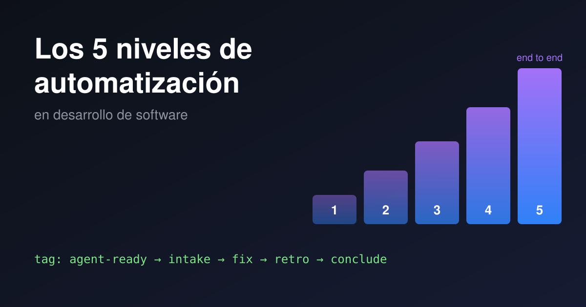

Hace unos meses escribí sobre cómo armé un **squad de 4 agentes de IA para corregir bugs**. En ese momento me parecía un salto enorme: un agente planea, otro arregla, otro revisa y otro aprende.

Pero había un detalle: yo seguía siendo el que apretaba el botón.

Yo abría la terminal, yo lanzaba el flujo, yo copiaba el ID del bug, yo esperaba. El trabajo pesado lo hacían los agentes, pero el proceso seguía dependiendo de mí para arrancar y para cerrar.

Hoy ese proceso ya no empieza en mi terminal. Empieza con un tag.

Y para explicar cómo llegamos ahí, me sirve pensar en algo parecido a los niveles de manejo autónomo de los coches, pero aplicados a desarrollo de software.

## Los 5 niveles

No es un estándar oficial. Es la forma en la que yo lo veo después de pasar por cada uno.

### Nivel 1 — Autocompletado

La IA te sugiere la siguiente línea o el siguiente bloque. Tú decides si lo aceptas.

Es útil, ahorra tecleo, pero tú sigues haciendo absolutamente todo: entender el problema, decidir la solución, compilar, probar, abrir el PR.

**La IA escribe. Tú piensas, ejecutas y cierras.**

### Nivel 2 — Asistente / chat

Le preguntas cosas a la IA: "¿por qué truena esto?", "¿cómo hago este query?", "refactoriza este método".

Te responde, tú copias, pegas y adaptas.

Aquí la IA ya participa en el razonamiento, pero sigue siendo una conversación. No toca tu código, no corre nada, no sabe si lo que te dijo funcionó.

**La IA sugiere. Tú aplicas.**

### Nivel 3 — Agente supervisado

Este es el salto grande. El agente ya no solo responde: **actúa**.

Lee archivos, edita código, corre el build, ejecuta los tests y te dice qué cambió. Herramientas como GitHub Copilot CLI o los coding agents viven aquí.

Pero tú estás encima todo el tiempo. Tú lo lanzas, tú le das contexto, tú revisas cada paso.

**La IA ejecuta. Tú diriges cada tarea.**

### Nivel 4 — Workflow multi-agente

En lugar de un agente que hace todo, tienes un flujo con etapas y roles claros: intake, investigación, fix, pruebas, retro.

Cada agente hace una sola cosa bien, tiene solo las herramientas que necesita y su salida es la entrada del siguiente.

Aquí estaba mi squad de bugs. El proceso ya era repetible, ordenado y mucho más confiable que un solo agente "todólogo".

Pero seguía arrancando a mano.

**La IA ejecuta un proceso completo. Tú lo disparas y lo cierras.**

### Nivel 5 — Automatización end to end

El proceso arranca solo, corre solo y termina solo. Tú intervienes donde de verdad aportas valor: en la decisión y en la revisión.

No significa "sin humanos". Significa que el humano deja de ser el pegamento entre pasos mecánicos.

**La IA opera el flujo. Tú defines las reglas y apruebas el resultado.**

## Cómo se ve el nivel 5 en la práctica

En uno de los proyectos en los que trabajo actualmente ya tenemos algo así funcionando. Y lo interesante es que no requirió nada exótico: runners de GitHub Actions, Azure DevOps y los mismos agentes que ya usábamos.

El flujo es este:

**Tag `agent-ready` en Azure DevOps → Intake → Fix → Retro → Conclude**

### 1. El disparador: un tag

Un bug o una user story está listo para que lo tome un agente. Alguien le pone el tag `agent-ready` en Azure DevOps.

Eso es todo.

Ese tag dispara el workflow en **runners locales de GitHub Actions**, conectados a Azure DevOps. Locales porque necesitan acceso al código, al entorno de build y a las herramientas del equipo, igual que un desarrollador.

### 2. Intake

Un script descarga todo lo relacionado con el work item: descripción, criterios de aceptación, comentarios, adjuntos, links a otros items.

Parece un paso aburrido, pero es de los más importantes. Un agente con mal contexto toma malas decisiones. Muchas veces el bug no está en la descripción, está en el tercer comentario o en el screenshot.

### 3. Fix

Aquí entra el trabajo pesado: el agente investiga el work item contra el código real, confirma la causa raíz, propone un plan, lo implementa, compila y corre los tests.

Si lo que encuentra en el código no coincide con lo que dice el ticket, no improvisa. Lo reporta.

### 4. Retro

Este paso es el que hace que el sistema mejore con el tiempo.

Al terminar, se registra qué pasó: qué era realmente el problema, qué lo arregló, qué costó trabajo encontrar. Eso se guarda como **memoria** del proyecto.

La próxima vez que aparezca algo parecido, el agente no arranca de cero.

### 5. Conclude

El cierre que antes hacía yo a mano:

- deja un comentario en el work item de Azure DevOps explicando el fix
- asigna los story points
- abre el pull request
- dispara el deploy

Cuando abro Azure DevOps, el trabajo ya está documentado, estimado y con un PR esperando revisión.

## Lo que cambia (y lo que no)

Lo que **cambia** es dónde pongo mi tiempo.

Antes: leer el ticket, buscar el módulo, reproducir, arreglar, compilar, correr tests, escribir el comentario, estimar, abrir el PR.

Ahora: decidir qué items están listos para un agente, revisar PRs con criterio y mejorar el workflow cuando algo sale mal.

Lo que **no cambia** es la responsabilidad. El PR sigue pasando por revisión humana. Si algo llega a producción, sigue siendo nuestro.

De hecho, el nivel 5 te obliga a ser más estricto, no menos:

- **Necesitas buenos work items.** Si el ticket es ambiguo, el agente también lo va a ser. La automatización expone muy rápido la mala calidad de los requerimientos.
- **Necesitas tests.** Sin tests, el agente no tiene cómo saber si rompió algo. Y tú tampoco.
- **Necesitas límites claros.** Qué puede tocar el agente, qué no, y en qué momento tiene que detenerse y pedir ayuda.
- **Necesitas observabilidad.** Si un run falla, tienes que poder ver en qué etapa y por qué.

## No todo debería ser nivel 5

No creo que todos los items deban ir directo al pipeline.

Un bug bien acotado, con pasos claros para reproducirlo, en un área con buena cobertura de tests: candidato perfecto.

Una decisión de arquitectura, una feature con mucha ambigüedad de negocio o un cambio que toca varias áreas sensibles: ahí todavía quiero estar yo, en nivel 3 o 4, trabajando junto al agente.

Por eso el tag es tan importante. **Un humano decide qué está listo.** El sistema no se autoasigna trabajo.

## Conclusión

Pasar del nivel 1 al 5 no se trata de usar "más IA". Se trata de convertir un proceso que vivía en la cabeza de cada desarrollador en un flujo explícito, con etapas, entradas, salidas y aprendizaje.

Los agentes ya existían. Lo que hizo la diferencia fue diseñar el proceso alrededor de ellos.

Y creo que ese es el skill que más va a valer en los próximos años: no solo saber escribir código, sino saber diseñar el sistema que lo produce, lo valida y lo entrega.

---

Saludos, devs!

**Sígueme en redes:**

[Twitch](https://twitch.tv/diegocod3s)

[GitHub](https://github.com/diego-devs)

[YouTube](https://www.youtube.com/channel/UCGQmO-aJ9yJSdv_VD8_IDjg)

[TikTok](https://www.tiktok.com/@diegoz.code)

[LinkedIn](https://www.linkedin.com/in/diego-diaz-mendoza/)

[Twitter](https://twitter.com/Diego_Devs)

[Instagram](https://www.instagram.com/devs.diego/)
